<p align="center">
  <picture>
    <source media="(prefers-color-scheme: dark)" srcset="docs/logo-dark.png">
    
  </picture>
</p>

<p align="center">
  <b>Track money, pay bills on time, split expenses with friends.</b>
</p>

<p align="center">
  
  
  
</p>

<p align="center">
  
</p>

---

## What is Coinbook?

Coinbook helps you answer three everyday questions:

| Question                        | Module                    | What it does                                                                                                                                                                                                 |
| ------------------------------- | ------------------------- | ------------------------------------------------------------------------------------------------------------------------------------------------------------------------------------------------------------ |
| "Where did my money go?"        | **Money tracking**        | Record income, expenses and transfers across wallets (bank, e-wallet, cash). See your balance, a running ledger and monthly reports.                                                                         |
| "What do I have to pay soon?"   | **Bills & subscriptions** | Add Netflix, internet, electricity and so on. Coinbook reminds you before the due date (Telegram or email). One tap on **Tandai lunas** records the payment.                                                 |
| "Who still owes me for dinner?" | **Split bill (patungan)** | Enter the receipt item by item, pick who had what, and Coinbook calculates each person's share including tax, service and discounts. Friends open a link (no account needed) and tell you when they've paid. |

All three modules write to **one ledger**, so a paid bill or a friend's transfer shows up in your balance automatically.

The look is inspired by real objects on a desk: a **bank passbook** for your transactions, **receipt slips** for split bills, and a **LUNAS stamp** when something is paid.

## Screenshots

| Landing                                                        | Dashboard                                    |
| -------------------------------------------------------------- | -------------------------------------------- |
| 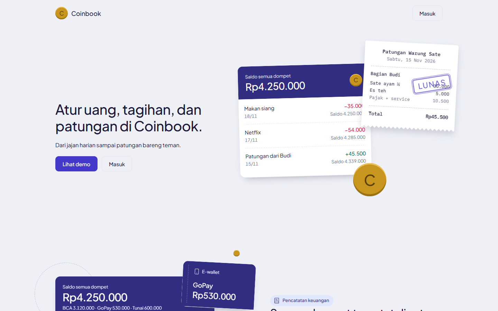                  | 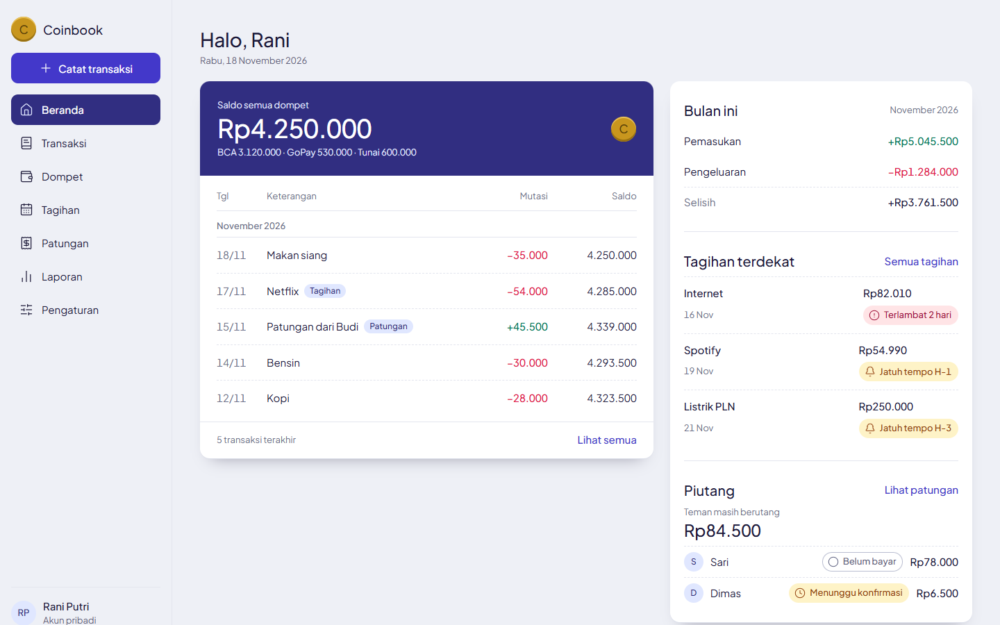 |
| **Transactions (passbook)**                                    | **Bills & subscriptions**                    |
| 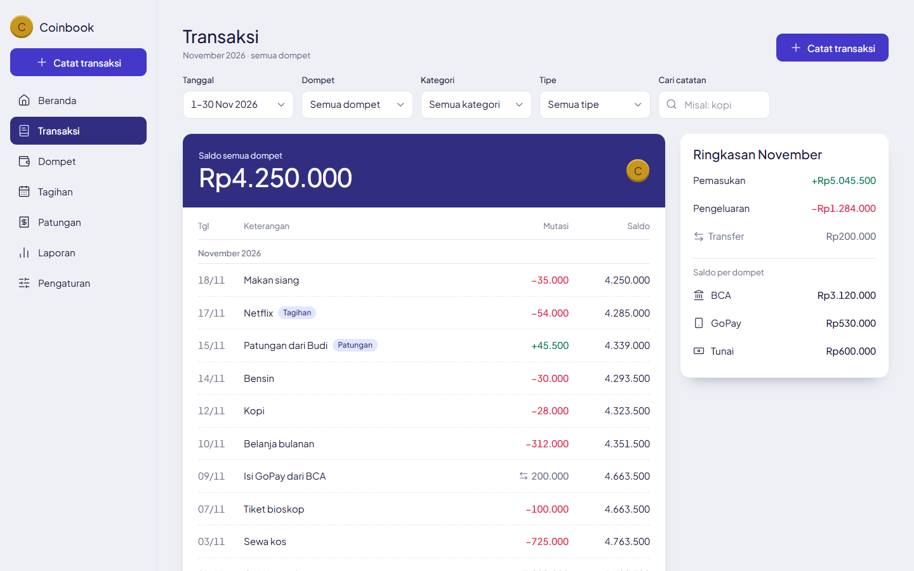             | 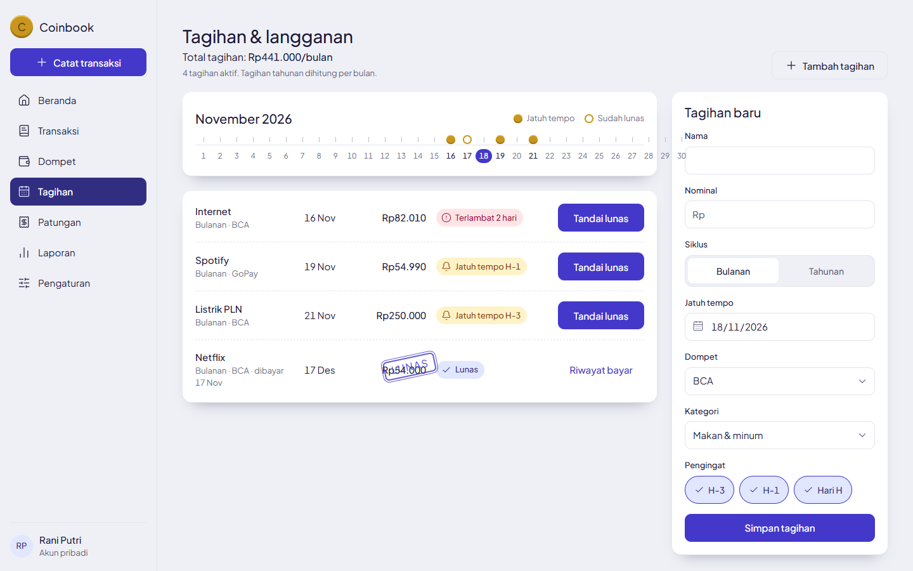         |
| **Split bill detail**                                          | **Reports**                                  |
| 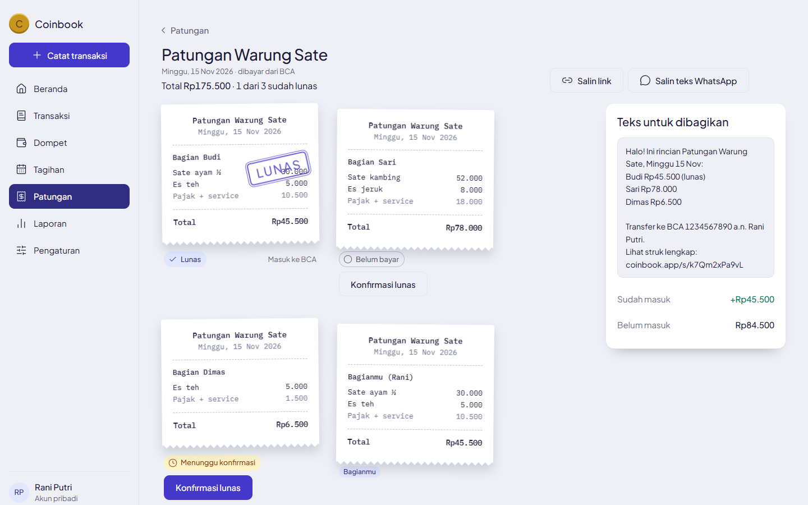        | 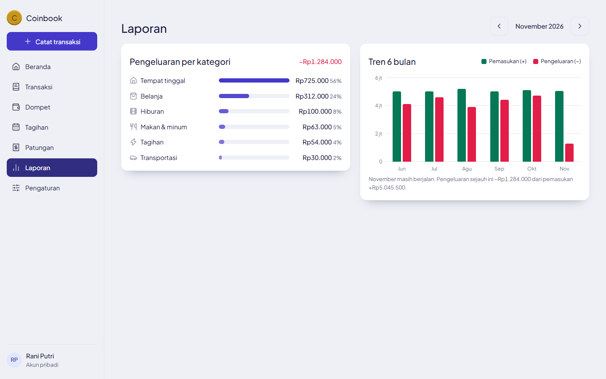     |
| **Dark mode**                                                  |                                              |
| 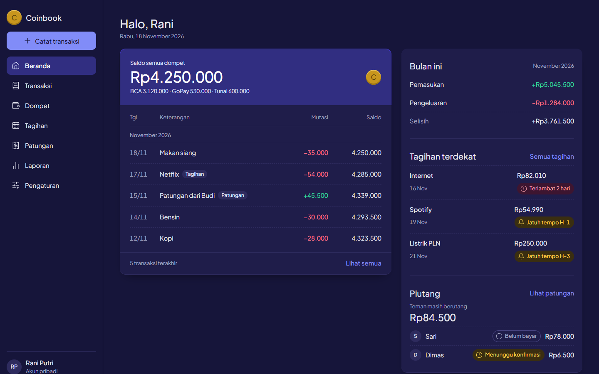 |                                              |

On a phone:

| Dashboard                                                                            | Bills                                                                        | A friend's view of a split bill                                                                    |
| ------------------------------------------------------------------------------------ | ---------------------------------------------------------------------------- | -------------------------------------------------------------------------------------------------- |
| 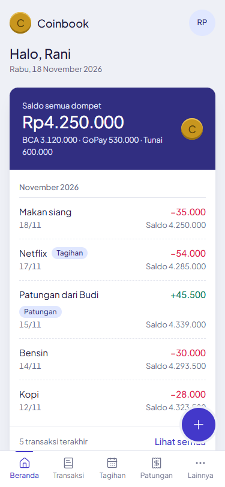 | 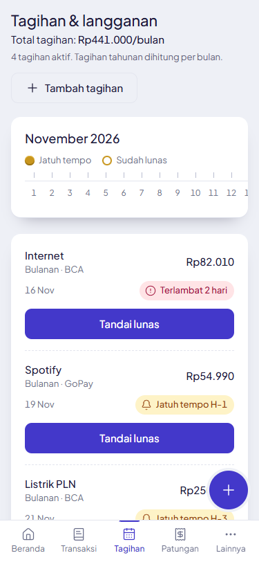 | 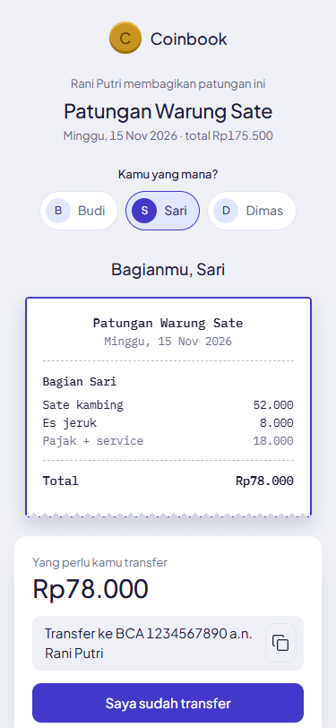 |

## Platforms

| Platform                          | Status          |
| --------------------------------- | --------------- |
| Web (desktop and mobile browsers) | Ready           |
| Android app                       | **Coming soon** |

The Android app will use the same API and the same account, so your data carries over.

## How it works (architecture)

In plain words: the **website** is what you see, the **API** is the brain that does the math and checks who may see what, and the **database** is where everything is stored. Signing in is handled by Supabase, so Coinbook never stores passwords.

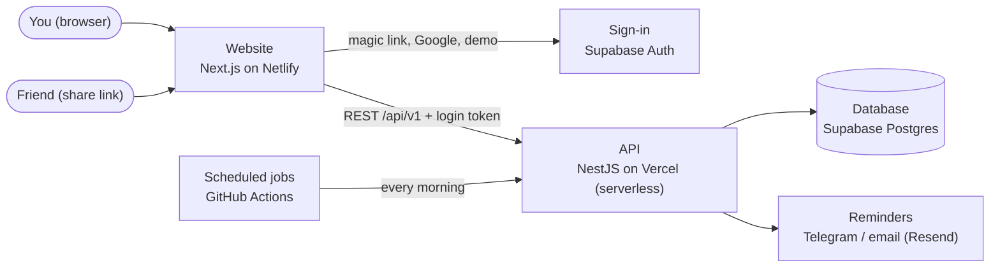

What happens when you mark a bill as paid:

1. The website sends the request to the API together with your login token.
2. The API checks the token with Supabase and makes sure the bill is yours.
3. In **one database transaction** it records the payment, creates the expense and lowers your wallet balance. If any step fails, nothing is saved, so your balance can never end up half-updated.
4. The website refreshes and shows the LUNAS stamp.

### The building blocks

|                                                                                   | Part                                  | Used for                                                             |
| --------------------------------------------------------------------------------- | ------------------------------------- | -------------------------------------------------------------------- |
|  | **Next.js 16** (React 19, TypeScript) | The website: pages, routing, server rendering                        |
|              | **Tailwind CSS 4**                    | Styling, light and dark theme                                        |
|               | **TanStack Query**                    | Loading and caching data from the API                                |
|                   | **NestJS 11**                         | The API: business rules, validation, rate limiting                   |
|     | **Prisma 6**                          | Type-safe database access and migrations                             |
|                      | **Zod**                               | Checking every input; the same rules are shared by website and API   |
|                 | **Supabase**                          | PostgreSQL database and sign-in (magic link, Google, anonymous demo) |
|                 | **Telegram Bot API**                  | Bill reminders and "my friend says they paid" messages               |
|     | **Resend**                            | The same notifications by email                                      |
|            | **GitHub Actions**                    | Checks on every push, daily reminder and clean-up jobs               |
|                  | **Netlify**                           | Hosting the website                                                  |
|     | **Vercel**                            | Hosting the API (serverless function)                                |
|         | **pnpm + Turborepo**                  | One repository for all parts, fast builds                            |
|                   | **Vitest, Jest, Playwright, axe**     | Unit, API, browser, design and accessibility tests                   |

### How the code is organised

```
coinbook/
├── apps/
│   ├── web/        the website (Next.js)
│   └── api/        the API (NestJS) + database schema and migrations (Prisma)
├── packages/
│   └── shared/     code both use: input rules, money and date helpers,
│                   the split-bill calculator, demo data
├── docs/           logo and screenshots for this README
└── .github/workflows/   CI and the daily scheduled jobs
```

### Rules that keep the numbers right

- **Money is always a whole number of Rupiah.** No decimals anywhere, so there are no rounding surprises. Percentages are stored as basis points (10% = `1000`).
- **Split bills never lose a rupiah.** Rp100.000 split three ways is 33.334 + 33.333 + 33.333; the shares always add up to the total. The server recalculates every split and ignores totals sent by the browser.
- **Indonesian time.** "Today", due dates and month boundaries use `Asia/Jakarta`.
- **Your data is only yours.** Every request is checked against your account. Someone else's data looks like it doesn't exist (404).
- **All-or-nothing money changes.** Anything that touches more than one record runs in a single database transaction. Pressing "paid" twice at the same moment results in one payment, not two.

## Run it on your computer

You need **Node.js 24**, **pnpm 11** (`npm install -g pnpm`) and a free **Supabase** account. Docker is not needed.

### Step 1. Get the code and install

```bash
git clone <this repository>
cd coinbook
pnpm install
```

### Step 2. Create the database and sign-in (Supabase)

1. Go to [supabase.com](https://supabase.com), create a new project (Singapore is the closest region) and save the database password you choose.
2. **Authentication → Sign In / Providers**: turn on **Email** and **Allow anonymous sign-ins**. Anonymous sign-in powers the "Lihat demo" button. Google is optional.
3. **Authentication → URL Configuration**: add `http://localhost:3000/auth/callback` to the redirect URLs.

### Step 3. Fill in the settings files

Copy the examples:

```bash
cp apps/api/.env.example apps/api/.env
cp apps/web/.env.example apps/web/.env.local
```

Then fill in these values from your Supabase project:

| File                  | Setting                         | Where to find it                                                                           |
| --------------------- | ------------------------------- | ------------------------------------------------------------------------------------------ |
| `apps/api/.env`       | `DATABASE_URL`                  | **Connect → ORMs → Prisma**, the line with port **6543**. Put your database password in it |
| `apps/api/.env`       | `DIRECT_URL`                    | Same place, the line with port **5432**                                                    |
| `apps/api/.env`       | `SUPABASE_URL`                  | **Project Settings → Data API**, Project URL                                               |
| `apps/api/.env`       | `CRON_SECRET`                   | Make one up: at least 32 random characters                                                 |
| `apps/web/.env.local` | `NEXT_PUBLIC_SUPABASE_URL`      | The same Project URL                                                                       |
| `apps/web/.env.local` | `NEXT_PUBLIC_SUPABASE_ANON_KEY` | **Project Settings → API Keys**, the publishable key                                       |

Everything else can stay as it is for now. Both apps check their settings when they start and say exactly what is missing.

<details>
<summary>All settings explained</summary>

**`apps/api/.env`**

| Setting                                                                  | Needed?           | What it does                                                                               |
| ------------------------------------------------------------------------ | ----------------- | ------------------------------------------------------------------------------------------ |
| `DATABASE_URL`, `DIRECT_URL`                                             | yes               | Database connection (pooled on 6543, direct on 5432 for migrations)                        |
| `SUPABASE_URL`                                                           | yes               | Used to verify login tokens (with the project's public keys)                               |
| `APP_URL`                                                                | yes               | Website address, used in share links and notifications                                     |
| `CORS_ORIGIN`                                                            | yes               | The website address allowed to call the API                                                |
| `CRON_SECRET`                                                            | yes               | Password the scheduled jobs send to the API (at least 32 characters)                       |
| `SUPABASE_SERVICE_ROLE_KEY`                                              | for demo clean-up | Lets the API delete expired demo accounts. Keep it secret and never put it in the website  |
| `SUPABASE_JWT_SECRET`                                                    | no                | Legacy JWT secret; only needed for the API tests                                           |
| `TELEGRAM_BOT_TOKEN`, `TELEGRAM_BOT_USERNAME`, `TELEGRAM_WEBHOOK_SECRET` | no                | Telegram reminders                                                                         |
| `RESEND_API_KEY`, `EMAIL_FROM`                                           | no                | Email reminders. Without them emails are only printed in the API log                       |
| `ENABLE_SWAGGER`                                                         | no                | `true` shows the API docs at `/api/docs` in production (always on locally)                 |
| `COINBOOK_FIXED_TODAY`                                                   | no                | Pretend today is a fixed date (e.g. `2026-11-18`) for tests. **Leave empty in production** |

**`apps/web/.env.local`**

| Setting                                                     | What it does                                        |
| ----------------------------------------------------------- | --------------------------------------------------- |
| `NEXT_PUBLIC_SUPABASE_URL`, `NEXT_PUBLIC_SUPABASE_ANON_KEY` | Sign-in                                             |
| `NEXT_PUBLIC_API_URL`                                       | Where the API runs (`http://localhost:3001/api/v1`) |
| `NEXT_PUBLIC_APP_URL`                                       | Where the website runs (`http://localhost:3000`)    |

</details>

### Step 4. Create the tables and start

```bash
pnpm db:deploy     # creates the tables in your Supabase database
pnpm dev           # website on http://localhost:3000, API on http://localhost:3001
```

Open **http://localhost:3000** and click **Lihat demo** to explore with ready-made data, or **Masuk** to sign in with your email and start empty.

<details>
<summary>Optional: load demo data into an existing account</summary>

```bash
pnpm build
SEED_USER_ID=<user id from Supabase Authentication> pnpm db:seed
```

This replaces that account's data with the demo data. Add `COINBOOK_FIXED_TODAY=2026-11-18` to pin the demo dates. Demo accounts created with "Lihat demo" are deleted automatically after 24 hours.

</details>

## Useful commands

| Command                                       | What it does                                                                                                          |
| --------------------------------------------- | --------------------------------------------------------------------------------------------------------------------- |
| `pnpm dev`                                    | Start website and API, reload on changes                                                                              |
| `pnpm lint` · `pnpm typecheck` · `pnpm build` | Code checks and production build (also run on every push)                                                             |
| `pnpm test`                                   | Unit tests for money, dates, bill cycles and the split calculator                                                     |
| `pnpm --filter api test:e2e`                  | API tests against a separate test database (see below)                                                                |
| `pnpm --filter web test:e2e`                  | Browser tests: main user flows, no sideways scrolling from 320 to 1920 px, accessibility (axe) in light and dark mode |
| `pnpm --filter web test:design`               | Compares every page pixel by pixel with the design                                                                    |
| `pnpm db:status`                              | Shows which database migrations are applied                                                                           |
| `pnpm db:migrate`                             | Creates a new migration after changing the database schema                                                            |

<details>
<summary>Running the tests</summary>

**API tests** wipe the database on every run, so they need a **second** Supabase project and refuse to run against the one in `apps/api/.env`. Create `apps/api/.env.test` with the same keys as `.env.example`, plus `NODE_ENV=test`, `PORT=3101`, `COINBOOK_FIXED_TODAY=2026-11-18`, and `SUPABASE_JWT_SECRET` set to the test project's legacy JWT secret (the tests create their own login tokens with it).

**Browser tests** use the Chrome installed on your computer. They start the API and a production build of the website automatically (or reuse ones already running on ports 3001 and 3000) and create demo accounts, which are cleaned up after 24 hours.

</details>

## Putting it online

Everything runs on free plans. **Free-plan limits change over time, so check each provider before you deploy.** The serverless API needs a few seconds for the first request after a quiet period, and free Supabase projects pause after a period without activity.

### 1. Database: Supabase

Use a Supabase project for production with the same sign-in settings as in Step 2. Add `https://<your-website>/auth/callback` to the redirect URLs and set the Site URL to your website. To send many sign-in emails, set up your own SMTP under **Authentication → Emails**.

### 2. API: Vercel (serverless)

The API runs as a serverless function on Vercel's free Hobby plan (no credit card). `apps/api/vercel.json` already holds the build settings; the function entry is `apps/api/api/index.js`, which loads the compiled `src/serverless.ts`.

1. Sign in at [vercel.com](https://vercel.com) with GitHub, choose **Add New → Project** and import the repository.
2. Set **Root Directory** to `apps/api`. Leave the framework on **Other**; build and install commands come from `vercel.json`.
3. Add the environment variables: everything from `apps/api/.env` except `PORT` and `COINBOOK_FIXED_TODAY`, with `NODE_ENV=production` and `APP_URL` / `CORS_ORIGIN` set to your website address.
4. Deploy. The build also applies the database migrations. Check `https://<project>.vercel.app/api/v1/health`.

To use your own address (e.g. `api.example.com`), add it under **Settings → Domains** and create the DNS record Vercel shows you.

Good to know: the first request after a quiet period takes a few seconds (the API starts up), and rate limits are counted per running instance. A long-running alternative is a Render web service (`render.yaml` blueprint), which needs a card for verification.

### 3. Website: Netlify

The repository includes `netlify.toml`, so Netlify already knows how to build the site (base `apps/web`, Node 24, pnpm 11, Next.js runtime). In Netlify choose **Add new site → Import an existing project**, pick the repository and add these environment variables:

| Variable                        | Value                       |
| ------------------------------- | --------------------------- |
| `NEXT_PUBLIC_SUPABASE_URL`      | Supabase project URL        |
| `NEXT_PUBLIC_SUPABASE_ANON_KEY` | Supabase publishable key    |
| `NEXT_PUBLIC_API_URL`           | `https://<your-api>/api/v1` |
| `NEXT_PUBLIC_APP_URL`           | Your website address        |

To use your own domain, open **Domain management → Add a domain** and either point your domain's nameservers to Netlify or create the DNS records Netlify shows. HTTPS is set up automatically.

### 4. Daily jobs: GitHub Actions

Two workflows are already included: **bill reminders** every day at 07:00 WIB and **demo clean-up** at 03:00 WIB. In the repository settings, under **Secrets and variables → Actions**, add:

- `API_URL`: `https://<your-api>/api/v1`
- `CRON_SECRET`: the same value as on Vercel

You can also start both jobs by hand from the **Actions** tab.

### 5. Telegram reminders (optional)

1. In Telegram, open [@BotFather](https://t.me/BotFather), send `/newbot` and follow the steps. You get a **token** and a **username**.
2. On Vercel, set `TELEGRAM_BOT_TOKEN`, `TELEGRAM_BOT_USERNAME` (without `@`) and `TELEGRAM_WEBHOOK_SECRET` (a random string of letters, digits, `_` or `-`).
3. Once the API is online, connect the bot to it once, from a computer whose `apps/api/.env` has the same token and secret:
   ```bash
   pnpm build
   pnpm --filter api telegram:set-webhook https://<your-api>
   ```
4. In Coinbook, open **Pengaturan → Hubungkan Telegram**. The bot opens with a one-time code, and reminders arrive in that chat from then on.

### 6. Email reminders (optional)

Create an API key with sending access at [resend.com](https://resend.com) and set `RESEND_API_KEY` and `EMAIL_FROM`. The test sender `onboarding@resend.dev` only delivers to your own Resend account; verify your own domain before sending to other people.

## Roadmap

- [x] Web app: money tracking, bills & subscriptions, split bill, reports, dark mode
- [x] Telegram and email reminders
- [ ] **Android app** (coming soon)
